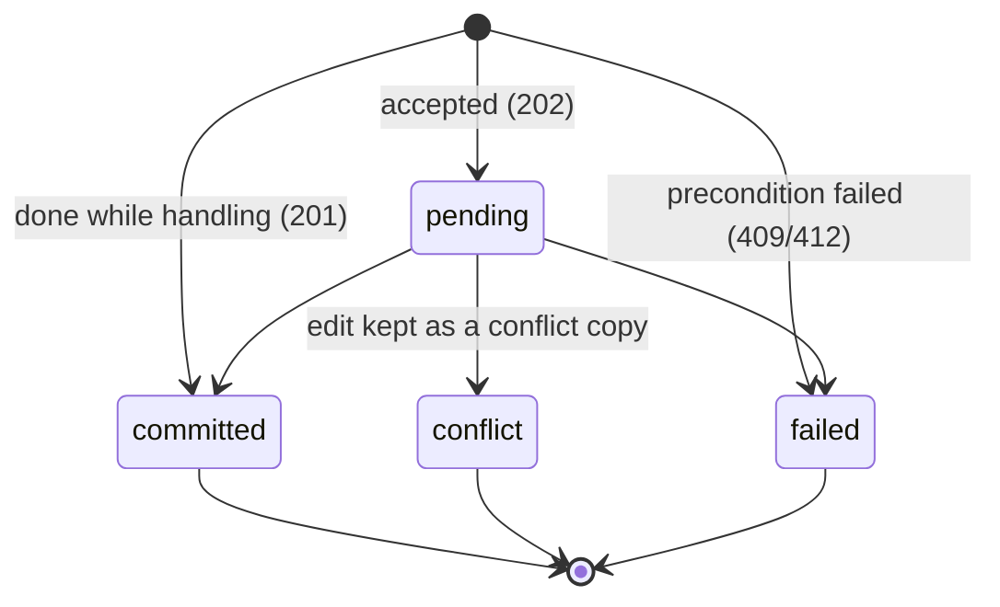

# Remote file API: invariants and failure states

This is the companion to [openapi.yaml](openapi.yaml), the version 1 contract between the gateway (the remote file
service in SushitrainCore's `gateway` package) and the shared Swift client in SynctrainFileProviderKit. The
[fixtures](fixtures) are examples both sides test against. The design and its reasons are in
[the plan](../remote-file-provider-plan.md).

## Identifiers and formats

| Value | Format | Notes |
| --- | --- | --- |
| Service ID | `svc_` + 22 base64url characters | Created with the service database; shown in the pairing QR code. |
| Item ID | `itm_` + 22 base64url characters | One per (folder, path); kept through API moves, also to another folder of the gateway (the folder it left lists a tombstone with `movedToFolderID`); a new ID after a deletion. |
| Lease, upload, snapshot, page, pairing request and server operation IDs | `lse_`, `upl_`, `snp_`, `pg_`, `prq_`, `op_` + 22 base64url characters | Unguessable (128 bits), bound to the issuing credential and folder. |
| Client credential | `stc_` + 43 base64url characters (256 bits) | Stored only as a SHA-256 hash on the gateway. |
| Lease, upload and pairing poll tokens | `stl_`, `stu_`, `stp_` + 43 base64url characters | Scoped to one resource; live as long as it does. |
| Client operation ID | UUID, lowercase | Chosen by the client; idempotency key together with its stable client identity. |
| Revision | `r1.` + 43 base64url characters | SHA-256 of the version vector, content identity, kind, mode, modification time and deletion state. Opaque. |
| Content identity | `c1.` + base64url(BlocksHash) + `.` + decimal length | Names one Syncthing block list. Equal bytes can have different identities. |
| Change cursor | `g<generation>.<sequence>` | Opaque to clients. |
| Times | RFC 3339 with `Z`; file modification times as `modifiedNs`, nanoseconds since 1970 | |
| Hashes | base64url without padding | Block hashes are SHA-256 of the block. |

The pairing QR code holds `synctrain+pair://<host>:<port>/?service=<service ID>&secret=<secret>[&spki=<hash>]`.
`secret` is 22 base64url characters (128 bits, single use, 10 minutes). `spki` is the base64url SHA-256 of the
certificate's SubjectPublicKeyInfo; without it the certificate must be trusted normally.

## Invariants

1. Every request except `POST /v1/pairing` is authorized: a client credential, or a scoped token for exactly the
   resource it was issued for. Every use rechecks the credential's current folder permissions. Revoking a credential
   revokes its scoped tokens.
2. Requests carry credentials only in `Authorization`, never in URLs. Redirects are never sent for `/v1` paths; a
   client treats a response from another origin as a protocol error.
3. A cursor names a point in one authority generation's change log. Applying all changes after a snapshot's cursor to
   that snapshot yields the gateway's state at the newest cursor. A cursor is never advanced past changes the client
   has not stored.
4. An item's revision changes whenever its content identity, version vector, kind, mode, modification time or deletion
   state changes. Equal revisions mean the client's copy is current.
5. A lease serves exactly one content identity. Every byte the gateway serves has passed SHA-256 verification against
   its block hash. A client publishes a download only after verifying every block against the manifest, and the
   manifest against the content identity.
6. An upload only stages bytes. Live files change only through operations.
7. An operation ID is applied at most once. Replaying it with the same payload returns the same operation; with a
   different payload, `422 operation_mismatch`.
8. An operation is reported `committed` only after the change is on disk durably, indexed by Syncthing, and recorded in
   the change log and the operation receipt. It confirms acceptance by the gateway, not replication to every device.
9. The gateway never overwrites a version the client did not name as its base. Racing versions are kept as conflict
   copies or the operation is rejected.
10. Failures found while handling `POST /v1/operations` answer `409` or `412`. Failures found after `202` are reported
    by `GET /v1/operations/{id}` as `conflict` or `failed`.
11. The authority generation changes whenever the gateway may have lost state: a reset or restore of Syncthing's or
    the service's database, or a new write authority. A restored service database is recognized by a client's cursor
    beyond the change log, which starts a new generation at most once per start of the service. Clients then take a fresh snapshot and treat operations they
    could not confirm as outcome-unknown, resolved through preconditions and user review, never by resubmission.

## Operation states

`outcomeUnknown` is a client state: an operation whose result the gateway can no longer report (after an authority
generation change, or once deduplication records expire).

## Gateway journal states

A mutation passes through these states in the service database. Each transition is durable before the next step.

| State | Meaning | Recovery after a crash |
| --- | --- | --- |
| `intent` | Request, payload digest and preconditions recorded. Live files untouched. | Re-run from the start: check preconditions again. |
| `staged` | New content is in place beside the target (temporary name), displaced content not yet moved. Its device and inode are recorded. | Reuse the temporary file if it is unchanged, otherwise stage again; check preconditions again. |
| `publishing` | Preconditions held and the change is about to happen. Recorded with its method (rename, swap, archive, mkdir, move, delete), final target name and, for moves, the moved entry's device and inode. | Look at disk: if the target is the staged file (or the moved entry, or the new directory), continue as `published`. If an archive moved the replaced file away but the rename didn't happen, finish the rename. If nothing happened, continue as before. A delete resumes removing what is left. Preconditions are not checked again once the change may have started. |
| `published` | Live files changed; displaced content archived or kept as recovery copy. | Check Syncthing's index for the expected version and `BlocksHash`. If absent, rebuild the entry from disk (only if disk still is the staged file) and commit it. If something replaced the file before it was indexed, index what is there and publish the edit again from its upload as a conflict copy. From here on the operation never fails; it keeps trying to finish. |
| `indexed` | Syncthing committed the entry. | Write the receipt and change log entry. |
| `receipted` | Result and change log entry stored. Terminal. | Nothing. |

## Failure-state matrix

| Failure | Gateway | Client |
| --- | --- | --- |
| Lost response to `POST /v1/operations` | Replay with the same ID and payload returns the stored operation. | Retries the same request, then polls `GET /v1/operations/{id}`. |
| Client suspended mid-upload | Keeps bytes received so far (without a per-request checksum) for 7 days. | `HEAD` for the offset, resumes from it. |
| Upload expired | `404` for the upload. | Restarts the upload from its staged local file; the operation is new only if it was never submitted. |
| Gateway restarts at any journal state | Recovers as in the journal table; the operation stays `pending` until then. On a normal stop, no change starts once stopping began, and changes in progress finish recording their state first. | Polls the operation. |
| Client revoked, or its write permission removed, while an operation is pending | Operations not yet publishing fail with `403`; those publishing or later finish. | Shows the failure for review. |
| Authority generation changed | Old cursors return `410 cursor_expired`; unknown operation IDs return `404`. | Fresh snapshot; unconfirmed operations become outcome-unknown. |
| Cursor older than 30 days | `410 cursor_expired`. | Fresh snapshot, keeping pending work. |
| Lease expired | `410 lease_expired`. | Requests a new lease; resumes only if the content identity is unchanged. |
| Block fails verification on the gateway | Discards that representation, schedules a scan, falls back to peers or answers `503` with `Retry-After`. | Waits and retries; keeps verified blocks. |
| Block fails verification on the client | n/a | Discards the range, refetches it; repeated failure is a protocol error. |
| Response from another origin | Never sent. | Protocol error; revokes the task's scoped token. |
| Credential revoked | `401`. | `notAuthenticated` in Files; keeps local work. |
| Storage exhausted | `507 insufficient_storage`. | Keeps the operation pending; surfaces it. |
| Replay after deduplication records expired, preconditions fail | If the intended result already holds, records `committed` and returns the current item. | As committed. |
