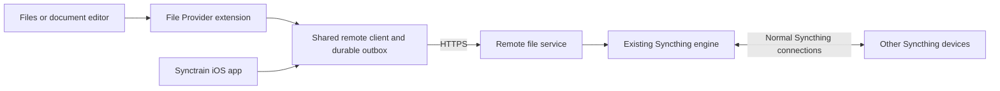

# Remote file access for the Files extension

Status: implementation plan, October 27, 2026. This replaces the proposed native iOS synchronization-engine rewrite.

## Goal and architecture

Make browsing, downloading, and editing remote files work directly from the iOS File Provider extension while the
Synctrain app is suspended or terminated. Keep the existing Syncthing engine and move synchronization work to remote
hosts that have the memory and execution time to do it efficiently.

The extension is an HTTPS file client. It does not run Syncthing, implement BEP, or depend on a loopback server in the
iOS app. The remote service, called the gateway below, exposes a small versioned API over its existing Syncthing
model. Other Syncthing devices continue to synchronize normally.

One configured gateway is the write authority for each folder. It must be running and reachable for remote operations
to complete. Cached files and pending edits remain available locally during an outage. iOS still controls execution
and transfer scheduling; this design does not promise continuous background execution or an immediate restart after
the user force-quits the app.

### Release boundaries and defaults

- Deliver the complete downloads-and-edits workflow in one release. Implement and test it in dependency order rather
  than shipping a replacement sync engine or a download-only interim feature.
- Host the service in Synctrain on macOS and in a headless Linux executable using the same Go core. Each host has one
  Syncthing engine owning its configuration and database; the existing application lock (`locations.LockFile`)
  enforces this, and a second engine must never start against a running instance's database. A deployment replacing a
  stock daemon stops that daemon, backs up its configuration, keys, and database, refuses a database schema newer than
  the pinned engine supports, and documents how to return to the stock daemon.
- The Linux host has no GUI. A command-line interface pairs clients (printing the pairing QR code and URL, and
  approving requests), revokes them, manages Syncthing devices and exported folders, and reports status. It refuses
  folders that use the system Trash (`basic-trash`), whose deletions need the macOS trash handler; Syncthing
  versioning is the alternative there.
- A macOS host must stay available without an open window: it starts at login and avoids App Nap while serving.
  System sleep is an ordinary outage.
- Require an explicitly configured HTTPS endpoint, reachable over a LAN, an existing VPN, or a configured public
  endpoint. Provide direct TLS and reverse-proxy support. Automatic public hosting, BEP protocol extensions, and
  tunneling HTTP through Syncthing relays are outside this release.
- Only gateway hosts need the added functionality. Stock peers can continue supplying content through the gateway's
  normal Syncthing connections. Upstream Syncthing adoption is not a release dependency.
- Writable gateway folders must be native filesystem folders in send-receive mode that are not selectively
  synchronized, so the gateway retains their full contents. A replace or delete stays pending (`202`) until the
  gateway's local copy is the operation's base revision. Folders exported without write permission for any client may
  be selective or receive-only, and stream content from connected peers when the gateway lacks a current local copy.
- Preserve the existing iOS deployment target. External folders, photo folders, symbolic links, and receive-encrypted
  folders remain excluded from Files. Preserve read-only access where the effective folder permissions require it.
- Keep the existing integration for folders without a gateway. Its current remote-access limitation remains visible;
  do not silently downgrade a configured gateway folder to that path during an outage.

## Ownership and local state

Avoid having both the iPhone's Go engine and the gateway publish the same edit.

Add a per-folder access mode: `syncthing` or `remoteAPI`. For `remoteAPI`, browsing, content access, and mutations in
both the app and extension use one shared Swift client, metadata cache, and outbox. The iOS Go engine must stop
scanning, pulling, and advertising local changes for that folder. Keep its configuration for later explicit mode
changes, but represent remote management separately from the user's pause preference: pause the folder in Syncthing
and persist a remote-managed flag that Go's `Folder.SetPaused(false)` refuses to override. Every resume path respects
it, including the Shortcuts intent, folder settings, the managed-base move's resume marker, and ignore reloads. Peers
see this device as paused for the folder. Other folders keep their existing Go behavior.

The Go indexer treats remote-managed folders as a third state: it keeps their rows, never applies Go records to them,
and never removes them for leaving its exposed set. `fetchContents` and the local writer never use the legacy folder
tree for them. Rebuilding the Synctrain location keeps the outbox, staged bytes, and gateway-ID mappings, and is
refused while remote operations are pending.

Remote folder contents live in a provider-owned cache outside the Go engine's watched folder tree. Retain cached
versions, immutable staged edits, base revisions, operation IDs, upload offsets, and background task IDs in the app
group. Keep staged edits and the outbox outside `Library/Caches` and `tmp`, which the system may purge, under the
shared container's existing `completeUntilFirstUserAuthentication` protection. Hand the system an APFS clone of a
cached representation so the cache and the system's copy share storage. Extend `SynctrainFileProviderKit` with
remote-client types and database tables; keep File Provider framework adaptation in the extension and app lifecycle
handling in the app.

Use short SQLite transactions and atomic filesystem publication. App and extension workers claim individual outbox
operations with expiring claims and generation checks; their claims are not permission to issue a second operation
with a different ID. After suspension or an uncertain response, query the original operation's status. No process
holds a database lock while awaiting networking.

Preserve existing Files item identifiers, tags, favorites, and last-used dates. Store gateway item IDs separately from
local row IDs. Keep dirty local overlays distinct from confirmed remote metadata so a refresh cannot overwrite an
unsent edit. A change-feed reset rebuilds remote metadata without removing pending operations or their bytes.

## Remote service and API

### Backend and authorization

Add a `RemoteFileService` around the existing Go `Client`, with a testable `RemoteFileBackend` interface for metadata,
versioned reads, mutation commits, and operation recovery. Reuse the current file server's local-file fast path, block
layout checks, peer block requests, and HTTP range handling. None of these verify block hashes today, and the local
fast path matches a file by size and modification time only. Reuse existing index events to drive a durable change
log. Do not expose the current loopback server or Syncthing's administrative API directly to the network.

The service is disabled by default. Enabling it selects exported folders, listening address, port, and TLS settings.
Pairing uses a short-lived, single-use secret of at least 128 bits, approved on the host with limited attempts, and
produces a revocable per-client credential with explicit folder and read/write permissions. The host stores only
credential hashes. On iOS, store credentials as non-synchronizable Keychain items available after first unlock on this
device only, in an access group shared by the app and extension (the app group can serve as one), and public
configuration in the app group. Support a normally trusted HTTPS certificate or a persistent self-signed certificate
whose public-key (SPKI) hash is delivered in the pairing QR code. Never accept arbitrary certificates. A key rotation
is announced over the current pinned connection before it takes effect; any other certificate change requires
re-pairing.

When a reverse proxy terminates TLS, clients see the proxy's certificate: it is either normally trusted or the
operator supplies its public-key hash for the pairing QR code. Supported proxy setups pass `Authorization`, `Range`,
`If-Range`, `ETag`, and the `Tus-*` and `Upload-*` headers unchanged; allow `PATCH`, `HEAD`, and `DELETE`; disable
request and response buffering; and use timeouts longer than the long poll.

Authorize every metadata, content, upload, and operation request. Authenticate through headers, redact secrets from
logs, reject credential forwarding to another origin, and avoid credentials in URLs. Background tasks never carry the
pairing credential. Creating an upload or a read lease returns a token scoped to that resource, which can only append to
that staged upload or read that lease's content; committing still requires the pairing credential. A scoped token lives
exactly as long as its resource (the upload's seven-day inactivity window, or the lease's 24 hours, renewed on use),
never a shorter fixed period, so a task the system defers cannot fail on token expiry alone. Revoking a credential
revokes its scoped tokens. Background sessions always follow redirects without consulting the delegate, so the gateway
and supported proxies never redirect `/v1` paths, and the client treats a response whose final URL has another origin as
a protocol error and revokes that task's token.

Lease, upload, snapshot, and operation IDs are unguessable (at least 128 bits) and bound to the issuing credential and
folder. Every use rechecks that credential's current permissions, an upload staged for one folder cannot commit into
another, and a repeated lease request for the same credential, item, and revision returns the existing lease. Enforce
path containment and symlink restrictions with directory-relative filesystem operations, not string-prefix checks.
Reject a mutation that targets a Syncthing-private name (the folder marker, `.stignore`, `.stversions`, `.syncthing.*`,
or `~syncthing~*`, as `isExcludedFromFileProvider` already excludes) with `403` and code `reserved_name`, and one
whose result the folder's ignore patterns would exclude with `409` and code `ignored_path`.

### Version 1 contract

Use JSON for bounded control responses and binary HTTP bodies for content. Define the API in a checked-in OpenAPI
document with shared request/response fixtures before implementing the Swift client. Changes within `v1` are additive:
clients ignore unknown fields, and optional features are gated by `capabilities`.

| Resource | Required behavior |
| --- | --- |
| `GET /v1/capabilities` | API version, service identity, authority generation, supported features, and configured limits. |
| `GET /v1/folders` | Only folders and effective permissions available to this paired client. |
| `GET /v1/folders/{id}/snapshot` | Paginated metadata snapshot that records the change cursor at its start. Pages may show later states; the client applies the changes after that cursor before treating the snapshot as complete. |
| `GET /v1/folders/{id}/changes` | Durable changes and tombstones after a cursor; optional bounded long-polling while the client runs. |
| `GET /v1/items/{id}` | Current metadata and revision, including any access or synchronization state. |
| `POST /v1/items/{id}/read-leases` | Bind an exact revision to a stable content representation, its size, and a paginated block-hash manifest. Preparation can return an operation ID. Also returns a read token scoped to the lease, for background tasks. |
| `GET /v1/content/{lease}/manifest` | Bounded pages of block offsets, lengths, and SHA-256 hashes, bound to the lease's content identity. |
| `GET` or `HEAD /v1/content/{lease}` | Authenticated immutable content, strong ETag, length, byte ranges, and resumable reads. |
| `/v1/uploads` | Resumable staged uploads using tus 1.0, with creation, checksum, expiration, and termination support. Creation also returns an upload token scoped to that upload, for background tasks. |
| `POST /v1/operations` | Create, replace, rename/move, or delete using a client operation UUID and explicit preconditions; return the durable operation ID. |
| `GET /v1/operations/{id}` | Recoverable pending, committed, conflict, or failed result, including resulting item revisions. |
| `GET /v1/items/{id}/thumbnail?revision={revision}` | Optional thumbnail for an exact content revision, rendered by the gateway, cached by content identity, and bounded in size; never required to open a file. |

Metadata includes an opaque item ID, folder and parent IDs, name, kind, size, timestamps, permissions, opaque revision,
and content identity. The revision incorporates the Syncthing version vector, content identity, and relevant metadata;
size and modification time alone are insufficient. A content identity names one Syncthing block manifest of the bytes
(its `BlocksHash`, computed from the block list when missing, plus the length) and is separate from the item revision.
Equal bytes can have different identities, because Syncthing keeps a file's previous block size when the new one is
within a factor of two. Track item IDs through API renames. Syncthing's protocol has no rename, so a rename performed
outside the API appears as a deletion and creation, and Files tags and favorites do not follow it.

The authority generation changes whenever the gateway may have lost state or its authority changed: a reset or restore
of Syncthing's database or the service database, or a new write authority for a folder.

Default metadata pages to 256 records and cap them at 1,024. Bound individual records and control-body size as well as
record count. Persist snapshot sessions without holding a database transaction open between HTTP requests. Snapshot
tokens expire after 24 hours; retain change cursors for at least 30 days. Expired cursors return `410` with code
`cursor_expired` and require a fresh snapshot, preserving local pending work. Never infer deletion from an unavailable
page.

Use `401` with `WWW-Authenticate: Bearer` for missing/expired credentials, `403` for denied access, `404` for a
nonexistent item, `409` for a name or operation conflict, `412` for a failed revision precondition, `410` for an
expired snapshot, change cursor (code `cursor_expired`), or read lease, `422` for an operation UUID replayed with a
different payload, `429` for load shedding, `503` for temporarily unavailable content, and `507` for exhausted storage,
including a preparation the cache quota rejects. `409` and `412` apply only to failures found while handling the
request; failures found after a `202` are reported as `conflict` or `failed` by `GET /v1/operations/{id}`. Under
`/v1/uploads`, tus status semantics take precedence. Return machine-readable error codes, a correlation ID, and
`Retry-After` where applicable.

### Reliable downloads

Create a read lease only for a representation that can be served without mixing file versions. Bind the lease to the
exact Syncthing block manifest, using a digest of that manifest and the file length as its content identity. Snapshot
local content with a filesystem clone where supported; otherwise populate an immutable spool from verified blocks. When
proxying another peer, pin the requested manifest and spool each verified block before serving it. The gateway verifies
every block's SHA-256 before spooling, serving, or caching it, including blocks read from a local clone, and never
caches a peer block that fails. When local bytes fail, discard that representation, schedule a scan of the path, and
fall back to peer blocks or return `503` with `Retry-After`. Readers may start when their requested blocks are ready; do
not make a cold open wait for the entire file to be fetched and then transferred a second time. Stream HTTP bodies
without buffering whole files in either process.

Cache prepared representations by content identity and coalesce preparation of the same version. Preparation can
start alongside the metadata request and runs with bounded gateway-side parallel block fetching. Missing blocks wait
on shared preparation, not a duplicate peer fetch. Keep preparation progress queryable instead of leaving the
extension waiting on a silent connection. An unavailable later block terminates the incomplete HTTP transfer; the
client retains only verified progress and cannot publish that partial file to Files.

Read leases last 24 hours and renew on use. A lease pins its representation against cache eviction until it expires.
Expired leases can be reacquired; resume a partial download only when content identity still matches. Cache quotas
include reservations for unfinished spools and reject new preparations before evicting a valid pinned representation.
Return the complete length and manifest identity before download so the client can check disk space and integrity.
Reuse Syncthing's existing block hashes instead of requiring a complete extra SHA-256 pass before a cold read starts.

In the foreground session, the extension uses file-backed `URLSession` range tasks aligned to manifest block boundaries.
Target 8 MiB ranges, allowing a complete 16 MiB block where required, and permit two ranges of one large file within the
global transfer limit. Verify each completed range against bounded manifest pages, record verified blocks durably, and
assemble the staging file with bounded filesystem buffers. Validate the manifest's identity incrementally and publish
only after all blocks pass. Cancellation loses at most unfinished ranges rather than the entire file; opaque URLSession
resume data is an optimization, not the only recovery mechanism. Resume using the original strong validator; a changed
validator requires a new transfer. If a server ignores ranges, discard that response as a protocol error rather than
appending it or repeating a whole-file download for each range. Parallel downloads share metadata and connection pools;
do not decode whole binary files or manifests into `Data`.

The system delays each new background task it schedules after relaunching the app, longer with each relaunch, so the
background session uses one task per transfer: it downloads the whole remaining range in one task and verifies its
blocks after completion.

Optional read fallback gateways may serve only an exactly matching version/content identity. A fallback cannot
silently return its own older current version. Do not fail over an uncertain mutation to a different authority.

### Reliable uploads and mutation commits

Stage every edited file immutably in the app group before network work. Compute its `uploadDigest` (the SHA-256 of
the whole staged file) incrementally, create a tus upload, and resume from the server-confirmed offset. In the
foreground session, use file-backed upload chunks, initially 8 MiB, without an 8 MiB in-memory allocation. The
background session sends the remainder from the confirmed offset as one `PATCH` from a file, reserving disk space for
that file, and omits the per-request tus checksum so the gateway keeps the bytes of an interrupted request. The
gateway serializes `PATCH` requests per upload, since an expired claim can let both processes send one, and enforces
a per-credential staging quota. An incomplete upload expires after seven days without activity; expiration restarts
the upload from the retained local staged file. Completed but uncommitted uploads stay pinned by their operation
until the result is resolved or explicitly abandoned; completed uploads that no operation references expire like
incomplete ones.

An upload only stages bytes. It does not replace a live file. Submit a separate mutation operation with its UUID,
base revision, `uploadDigest`, target parent/name, and operation-specific preconditions. The gateway verifies the
digest before commit and returns the committed content identity, which the client records for its staged copy so that
copy becomes a valid cached version without another download. Require nonexistence for creates and a matching base
revision for replacements and deletes. Check destination names and parent identities on moves. Directory operations
use a subtree-generation precondition covering descendant changes.

Persist the request, canonical payload digest, and recovery information before changing live state. Replaying the same
UUID with the same payload returns the same operation; a different payload is rejected. Key compact deduplication
records by a stable client identity created at first pairing and kept across credential rotation and re-pairing, and
retain them while the client is paired and for at least 30 days after revocation. When the authority generation changes,
or an uncertain operation outlives that retention, mark it outcome-unknown and resolve it through preconditions and user
review, never by blind resubmission. A replay with no deduplication record that fails its preconditions is first checked
against the current state: if its intended result already holds, the gateway records it as committed and returns the
current item instead of making a conflict copy. The result holds for a create or replace when the target parent and name
hold a file whose SHA-256 matches the `uploadDigest` (read in full, which only this rare path does), or a directory for
a directory create; for a delete when the target is gone; and for a move when the source is gone and the destination's
content identity matches the base revision's, since a coordinator move keeps the block list. This check never changes
live state. Return `202` while work remains and mark committed only after content and directory changes are durable,
Syncthing has indexed the result, and the operation result/change-log entry is persisted. This confirms gateway
acceptance, not replication to every peer.

Implement a mutation coordinator integrated with Syncthing's scanner and puller so precondition checks, publication, and
indexing cannot race those writers. The pinned engine has no such hook, so carry a Syncthing patch through a `go.mod`
`replace` with a minimal API: run a function in the folder's serve loop while scanning and pulling are held, and commit
a coordinator-built `FileInfo`. Plain filesystem writes followed by a scan are not sufficient. Preserve displaced
content with atomic filesystem operations and a recovery journal, and detect external filesystem changes before
declaring success. Retain racing versions as conflicts/recovery copies rather than silently discarding them. The journal
must distinguish every crash point between staging, filesystem publication, indexing, and final receipt, and recover
without applying a mutation twice. Syncthing's versioner archives only what its puller replaces or deletes, so the
coordinator calls the folder's versioner itself and uses the folder's filesystem (so `basic-trash` applies) for API
replacements and deletions.

The service keeps item IDs, the change log, operation receipts, deduplication records, and the recovery journal in its
own SQLite database next to Syncthing's, never inside it: Syncthing owns its per-folder storage, migrations, and resets.
The two databases share no transaction. A mutation records its intent durably, publishes to the filesystem, commits its
`FileInfo` through the hook, and then writes its receipt. Recovery resolves an operation interrupted after publication
by checking Syncthing's index for the expected version and `BlocksHash`, so that index remains the only authority on
what is indexed.

For each folder, the service database records Syncthing's index ID (`GetIndexID`) and the last local sequence it
consumed. At startup, a different index ID or a lower sequence means Syncthing's state was reset or restored without the
service's, and increments the authority generation. Change cursors encode the authority generation and change-log
sequence, so a client presenting a cursor beyond the head of the same generation reveals that the service database
itself was restored; the gateway then increments the authority generation, and clients take a fresh snapshot and handle
uncertain operations as after any generation change.

Preconditions cover the gateway's currently known state. An offline stock peer can later introduce a concurrent
version; normal Syncthing conflict handling still applies. Do not claim cluster-wide transactions or unanimous peer
acknowledgment. Other peer edits and ordinary desktop editors remain supported.

For conflicting saves, preserve the uploaded edit as a conflict copy unless the Files request explicitly requires
conflict rejection. Return the conflict result and resulting item ID. Conflicting deletes and moves are rejected,
leaving the original data intact. A same-host cross-folder move is one journaled, recoverable operation, not an
assertion of distributed atomicity. A cross-host move is copy, verify destination commit, then conditional source
deletion; a failed final deletion leaves both copies and a visible pending/error state. The iOS outbox runs it as one
compound operation that records each step's result. Version 1 moves only files across hosts. A cross-host directory move
is rejected with an error suggesting a copy followed by a delete, which take the ordinary create and delete paths;
same-host directory moves are unaffected. Check on a device whether Files offers its own fallback after that rejection,
and word the error to match.

## iOS execution, caching, and performance

Add shared types for `RemoteEndpoint`, `RemoteFolderBinding`, `RemoteItem`, `RemoteRevision`, `TransferRecord`, and
`MutationRecord`, plus an asynchronous `RemoteFileClient` for capability negotiation, snapshot/change retrieval,
content preparation, transfer scheduling, and operation reconciliation. Persist credentials separately from these
types. Keep server revisions distinct from File Provider content/metadata revision counters.

Use a foreground/default session for user-initiated metadata and transfers while the extension is executing, and
background sessions for durable uploads and eligible continuing downloads. Only one process can use a background
session at a time, so the app and the extension each own one with a distinct identifier; the app recreates the
extension's session only from `application(_:handleEventsForBackgroundURLSession:completionHandler:)`, to finish its
events. All sessions share one persistent transfer registry that records which session owns each task, stable task
descriptions, and the shared app-group container. A transfer has one active task; changing session type requires
cancel/reconcile/resume, not a second concurrent transfer.

Implement background session event handling in the app delegate and recovery when either process launches. Background
completion can run the containing app to finish bookkeeping, but never requires the user to open it. Do not keep File
Provider completion closures alive across process termination. Reconcile task IDs, on-disk bytes, upload offsets, and
server operation status after every uncertain result.

Report a create/modify/delete as synchronized only after its remote commit. During an outage, preserve both the
system's pending change and the shared staged copy, return `NSFileProviderError.cannotSynchronize` so the system
retries while browsing stays available (validate its retry cadence on a device), and reuse the same operation on the
system's next attempt. Report `.serverUnreachable`, which makes the system show the whole location as paused,
including legacy folders, only for an explicit user request while the gateway is down; report `.notAuthenticated` for
a `401`. Do not return success for an edit that only reached memory or an untracked temporary file. Maintain an
app-visible pending/conflict/error state and a way to export stranded edits. Signal resolved errors when connectivity
or authorization recovers, without treating one unavailable item as a reason to disable cached browsing for the entire
location.

Refresh remote metadata on provider activation, relevant enumeration, and execution opportunities granted by iOS.
Long-poll only while a process has execution time. Push notifications are not required for v1 correctness. Advance
change cursors only with the corresponding committed cache updates. Pause prefetch and thumbnails before delaying a
requested file or save.

Initial client scheduling allows four content transfer tasks, at most two uploads, two independent metadata requests,
and one thumbnail operation, across both processes through the shared transfer registry. Range tasks count toward the
same four-task limit, and a long poll occupies one metadata slot. Downshift concurrency under measured memory
pressure. These are tunable initial settings, not throughput guarantees. Keep gateway-side caches, peer selection, and
transfer concurrency independently tunable.

Thumbnails in remote-managed folders come from the gateway. A macOS gateway renders them with `QLThumbnailGenerator`,
which covers video, PDF, and most document types. A Linux gateway advertises video or PDF thumbnails in `capabilities`
only when `ffmpeg` or Poppler is installed; otherwise Files shows the generic icon. The extension decodes locally only
images it already holds, with bounded downsampling, and never streams video into AVFoundation. Folders without a gateway
keep their existing thumbnail path.

Measure release-build physical footprint on real devices, including networking, TLS, SQLite, and preview work.
Keep the peak below 15 MiB on supported test devices; this is a release gate to validate, not a documented universal
iOS allowance. The extension's `memoryFootprint()` trace exists only in debug builds, so measure release builds with
Instruments or MetricKit. File size and folder size must not cause proportional extension memory growth. Large files
remain supported subject to storage capacity. Prefer small in-memory caches, disk staging, and paginated metadata to
reducing protocol correctness or silently dropping files.

## Configuration, migration, and recovery

Expose gateway enablement, exported folders, pairing/revocation, pending operations, and storage/health status on the
remote host. Add iOS pairing and per-folder gateway mapping with clear reachability, permissions, and compatibility
status. The gateway keeps its own Syncthing device identity; its accepted edits are published under that identity,
with the originating client recorded in the service audit log. The audit log is separate from diagnostic logs,
records client, operation, and item IDs rather than filenames, and keeps entries for a retention period set on the host.

Migration to `remoteAPI` is explicit and per folder. First fence new edits. Before stopping that folder's Go activity,
wait until the gateway's completion for the folder shows it needs nothing whose current version came from this device,
or upload those versions with their announced revision as the base. Until the gateway confirms it holds that content, a
cached copy whose only source is this device is a dirty, non-evictable edit. Then stop the folder's Go activity and
account for all existing pending Files changes and local-only versions. Import them into the remote outbox with their
original base information, retaining recoverable local copies; never force an overwrite when a trustworthy base is
unavailable. Obtain a complete remote snapshot, map existing Files IDs, verify cached content identities, and atomically
switch the folder binding before allowing new edits. Preserve selections as local keep-on-device policy rather than
changing the gateway's full-replica selection.

If migration is interrupted, resume its journal before either engine can publish that folder. Do not delete old folder
data until migration and reconciliation are confirmed. Switching back to Go requires a foreground reconciliation,
resolution/export of pending operations, and a controlled ownership transition; endpoint outages never trigger it. It
starts from a reset local index for the folder (remove and re-add it) and an empty or verified directory; never delete a
folder's contents while keeping its marker and index. Changing a folder's write authority likewise requires resolving
old pending operations and a fresh snapshot. Multiple independent writers pretending to share an operation journal are
outside v1.

Keep remote-read cache eviction separate from dirty edits and keep-on-device policy. For remote-managed folders, Keep
on This Device and Stop Keeping change that local policy, not Syncthing selection. Never evict the only local copy
of an unacknowledged edit. Honor credential revocation and denied permissions without deleting recoverable local work.

## Implementation sequence and verification

1. Define the OpenAPI contract, invariants, version fixtures, and failure-state matrix. Add the backend abstraction and
   one-engine macOS/Linux service hosts. Prove paired HTTPS, local network access from the extension, and
   background-session authentication on a physical iPhone.
2. Implement durable snapshots, changes, immutable content preparation, and ranged reads. Replace whole-folder feed
   collection with bounded database iteration where necessary. Benchmark local reads and peer-backed preparation.
3. Implement tus staging, the model-integrated mutation coordinator and its Syncthing patch, durable receipts, and
   crash recovery. Verify conflicts and ordinary-peer propagation against real Syncthing instances before exposing
   writes to the extension.
4. Implement the shared Swift client, transfer registry, metadata cache, and outbox. Integrate Files callbacks,
   foreground/background sessions, error recovery, and app UI access to remote-managed folders.
5. Implement explicit per-folder migration, pairing/settings UI, keep/evict behavior, documentation, diagnostics, and
   complete device testing. Ship downloads and edits together only after all release gates pass.

### Correctness and failure tests

- Auth: expired/revoked credentials, wrong certificate, certificate rotation, cross-folder requests, resource IDs and
  scoped tokens used with another credential, folder, or resource, scoped tokens after expiry or revocation, malicious
  paths, reserved names, ignored paths, symlink swaps, cross-origin redirects, and proxies that strip headers or
  buffer bodies. Check background-session authentication after app/extension termination.
- Metadata: 100,000-entry folders, concurrent changes during pagination, expired cursors, restart/reset, permission
  changes, tombstones, Unicode/case collisions, case-only renames on case-sensitive and case-insensitive gateways, and
  preservation of dirty overlays and Files identifiers.
- Downloads: empty and multi-gigabyte files, ranges, interrupted/resumed transfers, changed versions, corrupt/truncated
  bodies, blocks that fail gateway verification, disk exhaustion, lost leases, clock skew around lease expiry,
  unavailable peers, proxy timeouts, read fallback, preparation coalescing, and gateway thumbnails with and without
  Linux renderers.
- Edits: create/replace/rename/move/delete, recursive changes, rejected cross-host directory moves, conflicting desktop
  and offline-peer edits, two iOS clients editing through one gateway, replayed callbacks, duplicate requests, lost
  responses, partial uploads, clock skew around upload expiry, gateway storage exhaustion during upload and commit,
  server restarts at every commit stage, a reset or restored Syncthing or service database, replays whose result
  already holds, and authority outages. Verify that no retry creates an extra edit or overwrites an unobserved version.
- Lifecycle: suspend or terminate either iOS process during every transfer stage; reconcile the background task and
  original operation without opening Synctrain. Exercise system retry callbacks and separately document force-quit
  scheduling behavior. Verify that local Go activity never republishes a remote-managed edit, including after resume
  attempts from Shortcuts and folder settings.
- Migration: existing unsent changes, announced but unreplicated local versions, selective folders, local conflict
  copies, offline gateways, interrupted cutover, rebuilding the Synctrain location, re-pairing, and return to legacy
  mode. Validate ordinary legacy folders and macOS synchronization for regressions.

### Performance and release gates

Benchmark on a physical iPhone/iPad and a macOS/Linux gateway with fixed fixtures and controlled LAN/WAN conditions.
Record p50/p95 open and commit latency, goodput, bytes retransmitted after interruption, peak physical footprint,
gateway CPU/disk use, and preparation cache hit rate. Separate network transfer time from server preparation, local
verification, and system scheduling.

For a prepared large local file over the same network, target at least 80% of the goodput of the same file served from
the same host by a plain static HTTPS server to a foreground `URLSession`. Reusing a prepared representation must not
download it from Syncthing peers again. Resuming an upload may repeat at most one unfinished foreground chunk, or in the
background only bytes the gateway never received; a download resumes from its durably recorded verified blocks rather
than restarting the entire file when the representation is still available. A 1,000-entry and 100,000-entry fixture must
stay within the same extension memory budget. The 15 MiB footprint limit and all no-data-loss/replay tests are release
gates. Do not claim measured throughput or memory results until these tests have run.

Before each test/build run, state an expected duration and enforce a timeout. Initial budgets are two minutes for a
focused unit suite, ten minutes for a local multi-peer integration group, and fifteen minutes per Xcode build; split
large device scenarios into named bounded cases. Capture partial output and stacks on overruns and investigate hangs
instead of extending budgets blindly. Build iOS and macOS, build the Linux service on Linux, run Go race checks for
the coordinator, and run the Swift package tests. No shipping claim is valid while required device/Linux checks remain
unavailable or failing.

Log correlation IDs, operation transitions, resume offsets, cursor resets, latency, and resource high-water marks on
both sides. Redact credentials and keep filenames/private content out of default logs. Surface actionable status for
authorization, reachability, missing peers, conflicts, and storage exhaustion.

## References

- [Current Files integration](file-provider.md) and its existing index, work queue, and storage behavior.
- [Existing content server](../SushitrainCore/src/fileprovider_server.go),
  [index feed](../SushitrainCore/src/fileprovider_feed.go), and
  [extension fetcher](../SushitrainFileProvider/ContentFetcher.swift): reuse candidates, not implementations of the
  remote durability and authorization guarantees in this plan.
- [Apple: replicated File Provider extensions](https://developer.apple.com/documentation/fileprovider/nsfileproviderreplicatedextension).
- [Apple: sharing containers and performing extension transfers](https://developer.apple.com/library/archive/documentation/General/Conceptual/ExtensibilityPG/ExtensionScenarios.html)
  (archived, and the source of the one-background-session-per-process rule).
- [Apple: background downloads](https://developer.apple.com/documentation/foundation/downloading-files-in-the-background).
- [HTTP semantics, ranges, and conditional requests](https://www.rfc-editor.org/rfc/rfc9110.html), plus
  [`429`](https://www.rfc-editor.org/rfc/rfc6585.html) and [`507`](https://www.rfc-editor.org/rfc/rfc4918.html).
- [tus resumable upload protocol](https://tus.io/protocols/resumable-upload).
- [Syncthing Block Exchange Protocol](https://docs.syncthing.net/specs/bep-v1.html) and
  [file versioning](https://docs.syncthing.net/users/versioning.html).
